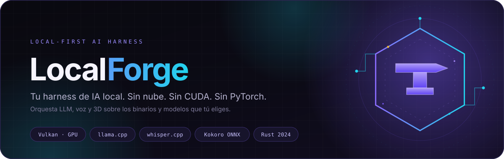
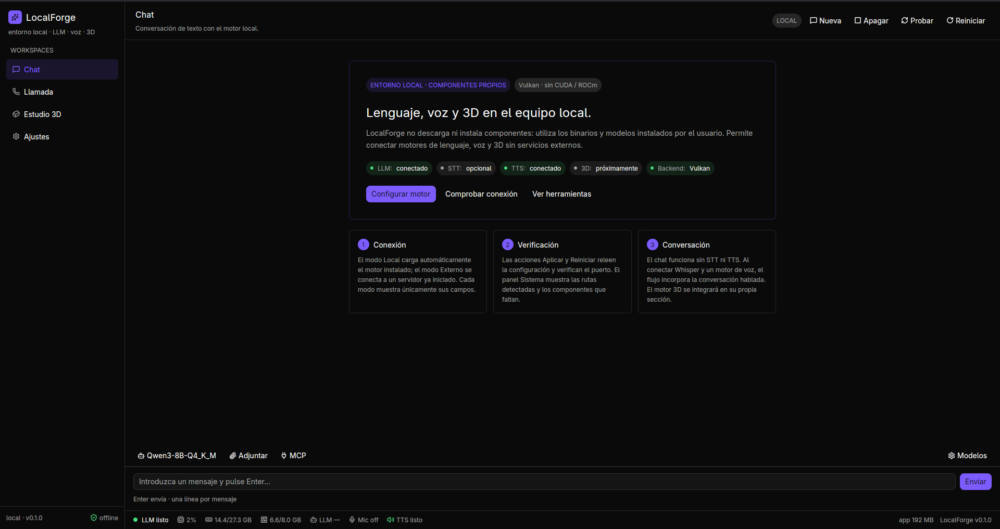
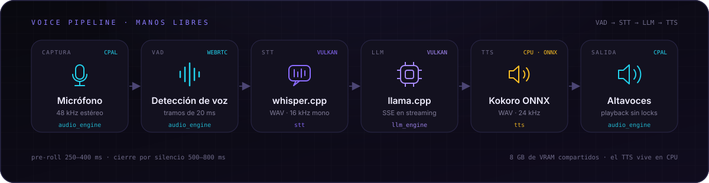
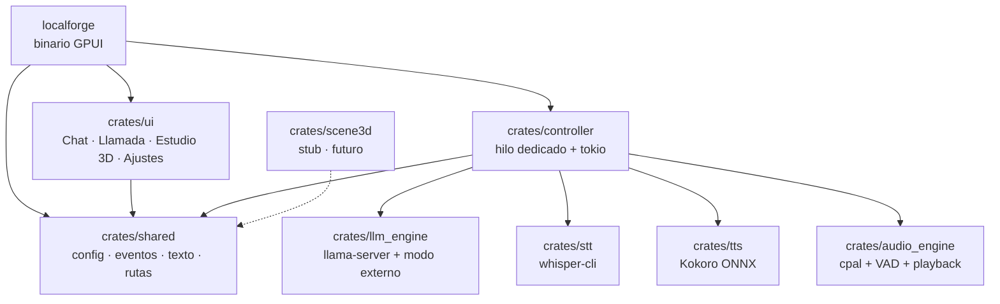

<div align="center">
  
  <br /><br />
  
  [](docs/ARCHITECTURE.md)
  [](docs/HARDWARE-VULKAN.md)
  [](docs/ARCHITECTURE.md)
  
  
  
</div>

<br />

<div align="center">
  
  <p><sub>Interfaz nativa: chat, estado de los motores y recursos del equipo en tiempo real.</sub></p>
</div>

---

## 🌩️ El problema

Montar IA local no debería significar pelearse con CUDA, instalar media docena de paquetes de Python ni enviar tus conversaciones a un servidor ajeno.

Y si tu GPU es una **AMD RX 5700 XT (RDNA 1)**, el problema es mayor: CUDA no existe para ti y ROCm nunca fue estable en `gfx1010`. La única ruta GPU que funciona sin parches de driver es **Vulkan**.

**LocalForge nació de esa frustración.** No es otro wrapper de chat: es un **orquestador de escritorio** que conecta tus propios binarios de inferencia, gestiona sus procesos y te deja configurarlo todo desde una interfaz nativa. Tú pones las rutas y los modelos; la app se encarga del resto.

> **Regla de oro:** si una dependencia exige CUDA, ROCm o PyTorch, se descarta. **Vulkan o CPU.**

### Hardware objetivo

| Componente | Objetivo |
| --- | --- |
| GPU | AMD RX 5700 XT · RDNA 1 (`gfx1010`) · 8 GB |
| CPU | AMD Ryzen 7 5700G · 8C/16T · sin NPU |
| RAM | 32 GB DDR4 |
| Backend | **Vulkan** (Mesa RADV en Linux) |

No es una lista cerrada: cualquier GPU con Vulkan funciona (AMD, NVIDIA, Intel), y en macOS se usa MoltenVK. El objetivo es que el hardware de gama media de 2019 siga siendo útil para IA local.

---

## ✨ Lo que hace

| Capacidad | Detalle |
| --- | --- |
| 🎮 **Vulkan first** | LLM y STT corren sobre `llama.cpp` y `whisper.cpp` compilados con Vulkan. Funciona en AMD, NVIDIA e Intel, sin tocar drivers ni instalar ROCm. |
| 🧩 **Core agnóstico a la UI** | Los motores son crates Rust testeables sin ventana. La UI solo intercambia `EngineCommand` y `EngineEvent`, así que puedes reemplazarla sin reescribir el core. |
| 🎛️ **Todo configurable** | Binarios, GGUF, capas GPU (`-ngl`), contexto, hilos, voces, VAD, tema… sin recompilar. |
| 🔒 **Privado por diseño** | Todo escucha en `127.0.0.1`. Prompts, audio y modelos no salen de tu equipo. Cero telemetría. |
| 🪶 **No bloquea la interfaz** | Escaneos, muestreo de recursos y audio viven fuera del hilo de GPUI. |
| 🔁 **Fallo recuperable** | Logs de los procesos hijos en un ring buffer, reinicio desde la cabecera y limpieza de procesos al cerrar. |

### Dos formas de conectar el LLM

| Modo | Qué hace |
| --- | --- |
| **Local** | Lanza `llama-server` con tu GGUF, aplica `-ngl`, espera el health-check y consume el streaming SSE. Encender, apagar y reiniciar desde la cabecera. |
| **Externo** | No lanza ningún proceso: sondea `/v1/models` y usa el modelo reportado. Compatible con Ollama, LM Studio o un `llama-server` ya iniciado. |

Cada modo muestra únicamente sus campos: en **Local** no verás endpoints y en **Externo** no verás rutas de binarios.

---

## 🎙️ El pipeline de voz

<div align="center">
  
</div>

<br />

- **`audio_engine`** captura con `cpal`, hace downmix y remuestreo a 16 kHz mono, aplica VAD WebRTC y detecta el final del turno con pre-roll y silencio configurable.
- **`stt`** invoca `whisper-cli` con un WAV PCM16 mono a 16 kHz, timeout y un parser tolerante que descarta `[BLANK_AUDIO]` y similares.
- **`llm_engine`** habla con `llama-server` o con un servidor OpenAI externo y streamea los tokens por SSE.
- **`tts`** limpia el Markdown y los emojis con `shared::text::for_speech`, sintetiza con Kokoro ONNX y reproduce el WAV resultante.

> La conversación por texto ya funciona de punta a punta. La captura, el VAD, el STT y el TTS están implementados; el bucle **manos libres** completo —barge-in y TTS solapado por frases— sigue en el roadmap. Lo que no está, no se simula: `scene3d` compila como stub honesto.

---

## 🧱 Arquitectura

Un workspace de **8 crates** con una frontera estricta: el core no conoce GPUI.



| Crate | Responsabilidad | Estado |
| --- | --- | --- |
| `shared` | Contrato UI ⇄ motores, configuración TOML, texto y resolución de rutas | ✅ |
| `controller` | Hilo controlador, procesos, HTTP/SSE, diagnóstico, CPU/RAM/VRAM y biblioteca GGUF | ✅ |
| `llm_engine` | `llama-server` gestionado, health-check, modo externo OpenAI | ✅ |
| `stt` | Wrapper de `whisper-cli` con WAV 16 kHz y parser tolerante | ✅ |
| `tts` | Sintetizador Kokoro (worker Python) y comando externo | ✅ |
| `audio_engine` | Captura `cpal`, VAD WebRTC, endpointing y playback | ✅ |
| `ui` | Vistas GPUI componentizadas y Ajustes por motor | ✅ |
| `scene3d` | Motor 3D futuro, con su contrato documentado | 💤 stub |

La UI nunca arranca un motor: solo envía comandos y pinta eventos.

```text
UI (GPUI) ──EngineCommand──► controller ──► llama.cpp · whisper.cpp · Kokoro · cpal
UI (GPUI) ◄──EngineEvent──── controller ◄── tokens · estado · recursos · errores
```

El controlador vive en su propio hilo con un runtime `tokio`; la UI sondea los eventos cada 50 ms. No se comparten locks entre la interfaz y los motores. Y no es una convención: `test/tests/boundary.rs` falla si el core importa GPUI.

---

## 🧰 Stack

| Capa | Tecnología | Backend |
| --- | --- | --- |
| Lenguaje | Rust 2024 · `unsafe_code = "forbid"` | — |
| Interfaz | GPUI Kit 0.9 | GPU del sistema |
| LLM | llama.cpp (`llama-server`) | **Vulkan** |
| STT | whisper.cpp (`whisper-cli`) | **Vulkan** |
| TTS | Kokoro 82M ONNX | **CPU** (ONNX Runtime) |
| Audio | `cpal` + `webrtc-vad` | CPU |
| Configuración | `figment` + TOML | — |
| Concurrencia | `tokio` + canales `crossbeam` | — |

El TTS corre a propósito en CPU: con 8 GB de VRAM, Kokoro no debe competir con el LLM ni con Whisper.

---

## 📊 Estado del proyecto

**Disponible hoy**

- ✅ Workspace modular de 8 crates y binario GPUI mínimo.
- ✅ Configuración segmentada y persistente (`config.toml`, `LOCALFORGE_*`, migración desde VoxLocal).
- ✅ Gestión de `llama-server`: encender, apagar, reiniciar, health-check y streaming.
- ✅ Modo externo para Ollama, LM Studio o un servidor ya arrancado.
- ✅ Biblioteca de GGUF con alias y detección de shards.
- ✅ STT con `whisper-cli`, TTS con Kokoro y audio con captura/VAD/playback.
- ✅ Monitor de CPU, RAM, VRAM y memoria de la app en el pie.
- ✅ Temas, color de acento, radio y tipografía ajustables en vivo.

**En camino**

- 🚧 Conversación manos libres con barge-in y TTS por frases.
- 🚧 Historial persistente, métricas de tokens/s y cancelación real del HTTP en curso.
- 🚧 Empaquetado e instaladores (`.deb`/AppImage, ZIP, `.dmg`).
- 💤 Motor 3D (`scene3d`), todavía sin backend.

Consulta el detalle y los criterios de aceptación en **[docs/ROADMAP.md](docs/ROADMAP.md)**.

---

## ⚡ Inicio rápido

> **Requisitos:** Rust 1.85+ (edición 2024), un driver Vulkan funcional y espacio en disco para tus modelos. LocalForge no descarga modelos automáticamente.

### 1. Dependencias del sistema

```bash
# Arch / CachyOS
sudo pacman -S --needed base-devel clang cmake vulkan-icd-loader alsa-lib libxkbcommon wayland

# Debian / Ubuntu
sudo apt install -y build-essential clang cmake libasound2-dev libfontconfig-dev \
  libwayland-dev libxkbcommon-x11-dev libx11-xcb-dev libvulkan1 mesa-vulkan-drivers
```

Comprueba que Vulkan ve tu GPU:

```bash
vulkaninfo --summary | grep -E 'deviceName|driverName'
```

### 2. Compila los motores con Vulkan

```bash
# llama.cpp
git clone https://github.com/ggml-org/llama.cpp
cmake -S llama.cpp -B llama.cpp/build -DGGML_VULKAN=ON -DCMAKE_BUILD_TYPE=Release
cmake --build llama.cpp/build -j --target llama-server

# whisper.cpp
git clone https://github.com/ggml-org/whisper.cpp
cmake -S whisper.cpp -B whisper.cpp/build -DGGML_VULKAN=1 -DCMAKE_BUILD_TYPE=Release
cmake --build whisper.cpp/build -j --target whisper-cli
```

Verifica que `llama.cpp` enumera el dispositivo:

```bash
llama-server --list-devices
# Vulkan0: AMD Radeon RX 5700 XT (RADV NAVI10) (8176 MiB, ...)
```

### 3. Descarga los modelos

```bash
mkdir -p assets/models/{llm,whisper,kokoro}

# LLM: Qwen3-4B en Q4_K_M es el punto dulce para 8 GB de VRAM
huggingface-cli download Qwen/Qwen3-4B-Instruct-2507-GGUF \
  --include '*Q4_K_M.gguf' --local-dir assets/models/llm

# STT: whisper small para español
curl -L -o assets/models/whisper/ggml-small.bin \
  https://huggingface.co/ggerganov/whisper.cpp/resolve/main/ggml-small.bin
```

| Motor | Modelo sugerido | Tamaño |
| --- | --- | --- |
| LLM | Qwen3-4B-Instruct · Q4_K_M | ~2,5 GB |
| STT | `ggml-small.bin` | 466 MB |
| TTS | `kokoro-v1.0.int8.onnx` + `voices-v1.0.bin` | ~115 MB |

Más opciones y enlaces en **[docs/MODELS.md](docs/MODELS.md)**.

### 4. Prepara Kokoro (TTS)

```bash
./tools/setup_kokoro.sh
```

Crea `.venv-kokoro/` con `kokoro-onnx` y ONNX Runtime **sin PyTorch**, y descarga los modelos en `assets/models/kokoro/`.

### 5. Ejecuta

```bash
cargo run --release
```

La primera vez, la app abre **Motor LLM** para indicar el binario, el GGUF o el endpoint externo. Después, configura el audio en **Ajustes → Motor Audio** y prueba una conversación.

> En Windows y macOS también funciona (Vulkan incluido en el driver AMD; MoltenVK en macOS). Los detalles por plataforma están en **[docs/HARDWARE-VULKAN.md](docs/HARDWARE-VULKAN.md)**.

---

## ⚙️ Configuración

La configuración se guarda en TOML y se puede sobreescribir con variables de entorno:

| Plataforma | Ruta |
| --- | --- |
| Linux | `~/.config/localforge/config.toml` |
| Windows | `%APPDATA%\localforge\config.toml` |
| macOS | `~/Library/Application Support/localforge/config.toml` |

```bash
# Doble guion bajo para anidar secciones; el prefijo antiguo VOXLOCAL_* sigue funcionando
LOCALFORGE_LLM__PORT=9931 cargo run --release
```

Los datos y logs viven en `dirs::data_dir()/localforge/`. Las claves nuevas tienen valores por defecto, así que un TOML parcial o antiguo nunca rompe el arranque.

---

## 🚀 Rendimiento en 8 GB de VRAM

- **4B Q4_K_M + contexto 4k–8k** es el punto dulce. Un **8B Q4_K_M** pide bajar a contexto 2k o usar Q3/IQ3.
- `-ngl 99` intenta todo; si el driver no cabe, prueba `-ngl 24–32` en un 8B.
- Whisper compite por VRAM cuando transcribe: usa `ggml-small` como máximo.
- La VRAM no es RAM. Un 8B con contexto 32k puede hacer swap y arrastrar todo el sistema.
- Compila siempre en `--release`: el perfil incluye `lto = "thin"`, `codegen-units = 1` y `strip`.

---

## 🧪 Calidad

```bash
cargo fmt --all
cargo clippy --all-targets --all-features -- -D warnings
cd test && cargo test
```

La suite vive en `test/`, un crate propio fuera del workspace. No necesita GPU, micrófono, modelos ni red externa, e incluye pruebas de frontera que impiden que GPUI se filtre al core. Lo que requiere hardware real se documenta como checklist manual en `test/docs/hardware.md`.

También hay pruebas de humo para el pipeline de audio (`test/src/bin/tone.rs` y `capture.rs`).

---

## 📚 Documentación

| Documento | Contenido |
| --- | --- |
| [docs/ARCHITECTURE.md](docs/ARCHITECTURE.md) | Crates, flujo de datos, hilos, contratos y ADRs |
| [docs/HARDWARE-VULKAN.md](docs/HARDWARE-VULKAN.md) | RDNA 1, presupuesto de VRAM, builds y diagnóstico |
| [docs/MODELS.md](docs/MODELS.md) | Modelos recomendados y descargas verificadas |
| [docs/ROADMAP.md](docs/ROADMAP.md) | Hitos y criterios de aceptación |
| [AGENTS.md](AGENTS.md) | Contexto y reglas para agentes que trabajen en el repo |

---

## 🤝 Contribuir

Las ideas, los issues y los PRs son bienvenidos. Antes de un cambio grande, abre un issue para acordar el enfoque. Para que un PR entre:

1. `cargo fmt --all` y `cargo clippy --all-targets --all-features -- -D warnings` en verde.
2. `cd test && cargo test` en verde.
3. Nada de CUDA, ROCm, PyTorch ni `unsafe`.
4. Si añades un motor, respeta el contrato `EngineCommand` / `EngineEvent`.

---

## 📄 Licencia

Distribuido bajo **MIT OR Apache-2.0**, la convención de la comunidad Rust: puedes usar el proyecto bajo los términos de cualquiera de las dos licencias.

<br />

<div align="center">
  <sub>Hecho con 🦀 Rust, ⚡ Vulkan y la convicción de que tu hardware no está obsoleto.</sub>
</div>
